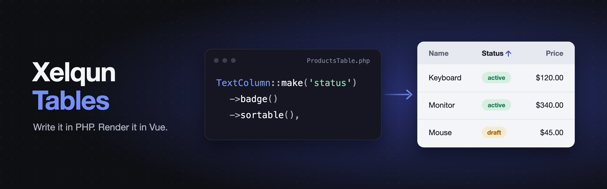

<p align="center">
    
</p>

<p align="center">
    <a href="https://packagist.org/packages/xelqun/tables"></a>
    <a href="https://www.npmjs.com/package/@xelqun/tables"></a>
    <a href="https://packagist.org/packages/xelqun/tables/stats"></a>
</p>

Describe a table in PHP and generic Vue components render it. Normal tables need no Vue at all.

> **Pre-alpha:** the API will change. Requires Laravel 13, Inertia 3, Vue 3.5, Tailwind 4 and [`xelqun/forms`](https://github.com/199ocero/xelqun-forms).

## Example

```php
class ProductsTable extends Table
{
    protected function boot(): void
    {
        $this->defaultSort('name')->paginationPageOptions([10, 25, 50]);
    }

    public function query(): Builder
    {
        return Product::query()->where('team_id', $this->context['team']);
    }

    public function columns(): array
    {
        return [
            TextColumn::make('name')->searchable()->sortable(),
            TextColumn::make('category.name')->searchable()->sortable(),
            TextColumn::make('status')->badge()->color(fn (string $state): string => $state === 'active' ? 'success' : 'gray'),
            TextColumn::make('price')->money('USD')->sortable(),
        ];
    }

    public function filters(): array
    {
        return [SelectFilter::make('category')->relationship('category', 'name')];
    }

    public function recordActions(): array
    {
        return [
            Action::make('archive')
                ->authorize('update')
                ->requiresConfirmation()
                ->action(fn (Product $record) => $record->archive()),
        ];
    }

    public function bulkActions(): array
    {
        return [
            BulkAction::make('delete')
                ->authorize('delete')
                ->action(fn (Collection $records) => $records->each->delete()),
        ];
    }
}
```

## Features

- **Write PHP, not Vue.** Normal tables need no frontend code.
- **Search and sort through relations.** Relations load up front, so rows don't each run a query.
- **Filters are form fields.** Anything `xelqun/forms` can do works in a filter, including dependent options.
- **Actions reuse forms.** Row, header and bulk actions get modals, uploads, live fields and notifications with no new code, and an `ActionGroup` puts them in a menu.
- **Links keep working.** Search, sort, filters and the page live in the URL, so a refresh or a shared link shows the same rows.
- **Secure by default.** Tables rebuild from an encrypted token, and every row comes back through your query on every request.
- **Custom columns.** A column of your own is a PHP class and a Vue cell.

## Installation

Tables is built on forms and uses its styles, so install both:

```bash
composer require xelqun/tables
php artisan xelqun-forms:install
php artisan xelqun-tables:install
```

The installers add the matching npm packages and import their stylesheets in `resources/css/app.css`.

## Usage

```php
class ProductController
{
    public function index(Request $request)
    {
        return Inertia::render('Products/Index', [
            'table' => ProductsTable::make(['team' => $request->user()->team_id])->toSchema(),
        ]);
    }
}
```

```vue
<script setup lang="ts">
import { XqTable, type TableSchema } from '@xelqun/tables';

defineProps<{ table: TableSchema }>();
</script>

<template>
    <XqTable :table="table" />
</template>
```

`php artisan make:xelqun-table ProductsTable` creates a table class.

## Editing in the table

`ToggleColumn`, `CheckboxColumn`, `TextInputColumn` and `SelectColumn` save as you change them. They're read-only until `authorize()` says who can edit, the same as actions:

```php
ToggleColumn::make('is_featured')->authorize('update'),
TextInputColumn::make('name')->authorize('update')->rules(['required', 'max:120']),
SelectColumn::make('status')->authorize('update')->options(['draft' => 'Draft', 'live' => 'Live']),
```

The row comes through `query()`, and a select only takes its own options. For a relation's column, or anything else, use `updateStateUsing(fn ($state, $record) => ...)`.

## Summaries and groups

`summarize()` adds lines under a column, worked out over every row of the search and filters, not just this page, and formatted like the column:

```php
TextColumn::make('price')->money('USD')->summarize([Sum::make()->label('Total'), Average::make()]),
```

`Count` and `Range` work the same way. `defaultGroup('status')` in `boot()` puts rows under a heading for each value, and keeps a group together whatever the sort.

## More table options

**Query builder.** `QueryBuilder::make('rules')->constraints([...])` is a filter where people build their own rules, matching all or any. Use `TextConstraint`, `NumberConstraint`, `DateConstraint`, `BooleanConstraint` and `SelectConstraint`, with dots for a relation. Only the constraints you list can be asked about, and a rule with a bad value is skipped.

**Reordering.** `reorderable('sort', fn (): bool => auth()->user()->isAdmin())` in `boot()` adds up and down buttons. It's off until the closure says yes, and both rows come through `query()`.

**Layout.** `toggleable()` on a column lets the viewer hide it, and `toggleable(isHiddenByDefault: true)` starts it hidden. `contentGrid(3)` shows rows as cards. `striped()` shades every other row. `poll('10s')` keeps a table fresh.

**Enums.** If a column's value is a cast enum, its `getLabel()`, `getColor()` and `getIcon()` fill in the cell. The column's own `color()`, `icon()` and `formatStateUsing()` win.

## Plugins

Other packages can add columns, with the same sorting, search and links as built-in ones. A tables plugin is a forms plugin, so install one with `php artisan xelqun-forms:plugin acme/sparkline`, or build one with the [plugin guide](docs/plugins.md).

## Before going to production

- **Add your rules to `authorize()`.** It allows everything by default.
- **Give each action its own `authorize()`.** An action does nothing without one, and the table's `authorize()` doesn't count.
- **Scope `query()` to what the viewer may see.** Every row and every action stays inside it, so this is your main line of defence.

## Things to know

- **`query()` also runs on the table's own requests**, where the page's route parameters are gone. Pass what it needs through `make($context)`, as above. The context travels in an encrypted token, so keep it to scalar values.
- **`authorize()` runs on every request.**
- **A missing `authorize()` on an action hides its button.**
- **Closures get values by parameter name.** Write `$record`, `$records`, `$state`, `$query`, `$data` or `$direction`. Another name gets a value from the container, not your row.
- **`$set` and `$get` do nothing in a table action**, because the table has no form state. Use the record.
- **Don't use `Action::record()` in a table.** The table already finds the row.
- **Hidden columns are left out entirely.** They aren't sent, searched or sorted.

## Current limits

- A list in a cell has one color and icon, and its `color()` closure receives the array.
- `%` and `_` in a search act as wildcards.
- A relationship `SelectFilter` sends every related record. For a long list, use a `Filter` with an async `Select`.
- Sorting through a relation works over one `BelongsTo` or `HasOne`. Anything else needs a closure.
- A column that isn't a real column, such as a `withCount()` alias or an accessor, needs a closure to sort or search.

Grouping, summaries, reordering, editable columns and session persistence aren't built yet.

## Inspiration

Xelqun Tables is heavily inspired by [Filament](https://filamentphp.com). I'm a big fan of Filament and have built several packages for it, and this project brings its PHP-first way of building tables to Inertia and Vue.

## License

MIT
